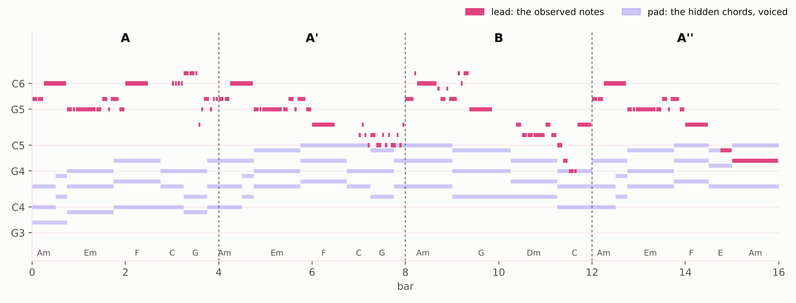
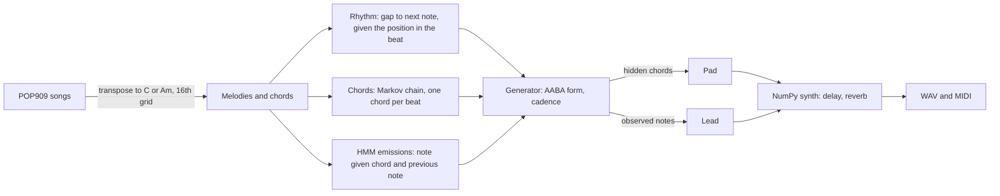
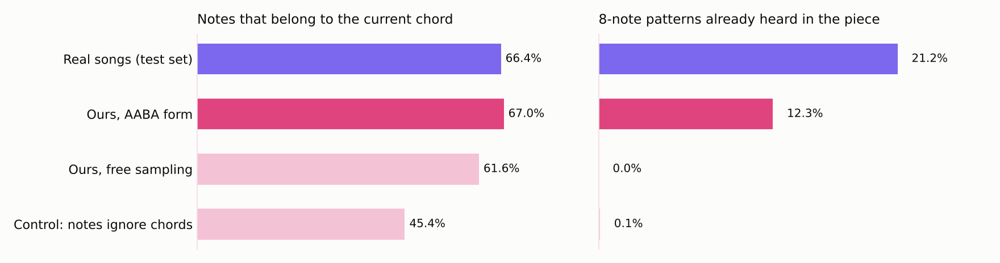

# Ethereal HMM

<p align="center">
  
</p>

**Dreamy synth melodies from a hidden Markov model written from scratch: the hidden states are chords, and you can hear them.**


## In 30 seconds

An HMM explains what you observe with a sequence of states you do not see. Here the observations are the
notes of a melody and the hidden states are the chords under it. Trained on 909 pop songs, the model
generates new melodies together with their chords; the chords become a soft synth pad and the notes the lead.

* The HMM is written from scratch (forward-backward with scaling, Viterbi, posterior decoding, Baum-Welch),
  and **every algorithm is tested against brute force** over all possible state paths
* Generated notes fit their chord as often as real melodies do: **67.0% vs 66.4%**, against 45.4% when the
  notes ignore the chord
* Free sampling never repeats itself; an **AABA form** brings repeated material from 0% to 12% (real songs:
  21%), and every piece closes on a proper cadence
* **Left alone, Baum-Welch does not discover chords.** It learns melodic motion instead (repeat, rise, fall),
  which predicts notes 2% better but says little about harmony
* Everything runs on NumPy and the standard library, including the MIDI reader and the synthesizer

## Listen

Each link opens an MP3 file of about 40 seconds (the reference song: 1 minute).

| Piece | Tempo | Airy | Dreamy |
|---|---|---|---|
| Seed 1, the piece in the figure above | 116 bpm | [listen](audio/seed1_airy.mp3) | [listen](audio/seed1_dreamy.mp3) |
| Seed 2 | 130 bpm | [listen](audio/seed2_airy.mp3) | |
| Seed 0 | 131 bpm | | [listen](audio/seed0_dreamy.mp3) |
| Reference: a real song from the test set, same synth | 45 bpm | [listen](audio/reference_song571_airy.mp3) | |

The two sounds differ only in rendering: *dreamy* has a softer lead, a slower pad and a 7-second reverb.

## How it works



1. **Data.** Each song's melody and annotated chords are moved to C major or A minor and put on a grid of 16th notes
2. **Model.** The chord changes once per beat; at every note, the HMM draws a pitch from P(note | chord, previous note).
   Rhythm and chord progressions have their own small models
3. **Form.** A 4-bar theme is played three times (A A' B A''); the repeats keep its first half and answer differently.
   The last bar goes from the dominant to the home chord (E to Am, G to C), with the melody stepping down to the root
4. **Sound.** Additive synthesis: two detuned oscillators with slow vibrato for the lead, a dark detuned pad whose
   chords move as little as possible from one to the next, a ping-pong delay and a convolution reverb

## Results

<p align="center">
  
</p>

Fifty generated pieces of 16 bars compared with 160 phrases from test songs. The control uses the same rhythm
and chords, but its notes depend only on the previous note: the gap between 67% and 45% is what the hidden
chords contribute. Step sizes between notes (repeat, step, leap) match the real melodies within 3 points.

## What the HMM learned, and what it did not

Bits per note on held-out songs (lower is better; guessing uniformly over 12 notes costs 3.585 bits):

| Model | Bits per note | Chord recovered from the melody |
|---|---|---|
| Best Markov chain (order 2) | 2.358 | |
| HMM, states = annotated chords | 2.381 | **36.9%** |
| HMM learned by Baum-Welch, 50 states | **2.309** | 23.6% |
| Guess the chord from the current note only | | 28.2% |

* **Chords alone explain melodies poorly.** Melodies move by small steps; the chord mostly decides which of the nearby
  notes comes next. Letting each note depend on the previous one as well brought the chord HMM from 2.63 to 2.38 bits
* **The decoder matters.** Viterbi (the single best path) recovered only 24.5% of chords, below the one-note guess,
  because it over-smooths chords that last several notes. Posterior decoding (the best chord at each note) gets 36.9%
* **EM optimizes likelihood, not meaning.** Without labels, the states that help prediction most are not chords.
  With few states each one becomes a single note; given the previous note, they become "repeat", "rise" and "fall"
* That is why generation uses the HMM trained with the annotated chords: it predicts slightly worse, but its
  hidden states are exactly what the pad needs

## How the results were checked

* **Brute force for every inference algorithm.** Likelihood, posteriors, Viterbi, posterior decoding and one EM step
  are compared with explicit sums over all K^T state paths on small cases
* **Split by song.** 605 / 76 / 76 songs for training, validation and test; smoothing and model orders are chosen on
  validation songs, numbers reported on test songs
* **Seeds.** Baum-Welch results are averaged over 3 random starts (standard deviation 0.003 to 0.017 bits)
* **Likelihood is not enough.** The best-scoring Markov chain produced chromatic noise when sampled, because its
  smoothing makes unseen contexts uniform; samples are listened to, not only scored
* **Bugs found by tests and fixed.** An emission of probability 0 for unseen note pairs, a release envelope starting
  from the wrong level, and normalization applied before the fade-out
* **161 unit tests**, one command per figure and table

## Try it

```bash
git clone https://github.com/music-x-lab/POP909-Dataset.git ../POP909-Dataset
python3 -m venv .venv && source .venv/bin/activate
pip install -e ".[dev]"
pytest -q
python scripts/generate.py --seeds=0,1,2
```

Each seed is written to `outputs/` as `_airy.wav`, `_dreamy.wav` and a MIDI file with LEAD and PAD tracks.
Options: `--form=ABAB`, `--bpm=110` (default: drawn between 99 and 136), `--preset=all`.
Every experiment has its own script; all commands and results are in [docs/RESULTS.md](docs/RESULTS.md).
The README figures need `pip install -e ".[figures]"` (matplotlib).

<details>
<summary><b>Repository layout</b></summary>

```
src/hmmusic/midi.py       MIDI file reader and writer (pure Python)
src/hmmusic/pop909.py     load POP909 melodies, chords, beats and keys
src/hmmusic/frames.py     transpose, 16th note frames, phrases, note sequences
src/hmmusic/markov.py     Markov chains with additive or Witten-Bell smoothing
src/hmmusic/hmm.py        HMM: forward-backward, Viterbi, posterior decoding, Baum-Welch
src/hmmusic/generate.py   rhythm model, chord chain, AABA form, cadence
src/hmmusic/synth.py      additive synth, voice leading, delay, reverb, WAV output
src/hmmusic/decode.py     frames back to MIDI notes
src/hmmusic/stats.py      permutation test for the listening test
scripts/                  one script per experiment, figure or output
tests/                    unit tests
docs/RESULTS.md           every experiment and number
```
</details>

## Limitations

* No listening study yet: a blind test (real vs generated vs control, `scripts/listening_test.py`) is built but not run
* Chords are reduced to major and minor triads; the 152 songs that change key are left out
* Notes are pitch classes; the octave is chosen by a rule (closest to the previous note)
* The form is designed by hand (AABA), not learned; the rhythm model only sees the previous gap
* One dataset of Chinese pop songs: the "ethereal" character comes from the synth and the tempo, not from the data

## Data and credits

* **POP909**: Wang, Z., Chen, K., Jiang, J., Zhang, Y., Xu, M., Dai, S., Bin, G., Xia, G. (2020). *POP909: A Pop-song
  Dataset for Music Arrangement Generation.* ISMIR. MIT license
* **HMMs**: Rabiner, L. R. (1989). *A tutorial on hidden Markov models and selected applications in speech recognition.*
  Proceedings of the IEEE
* **Witten-Bell smoothing**: Witten, I. H., Bell, T. C. (1991). *The zero-frequency problem: estimating the probabilities
  of novel events in adaptive text compression.* IEEE Transactions on Information Theory

The dataset is not included in this repository; it is cloned next to it. Code under the [MIT license](LICENSE).
